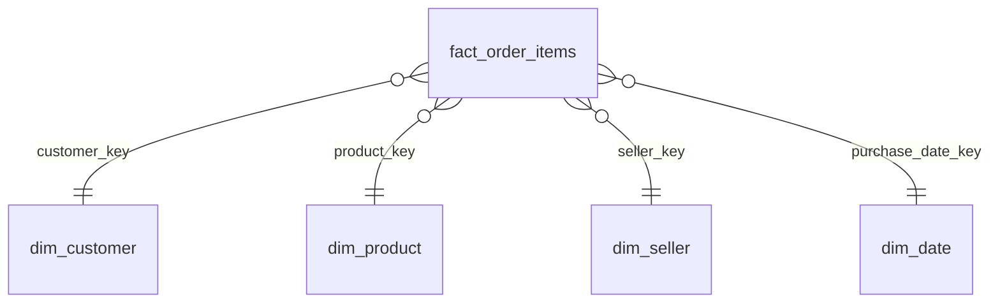
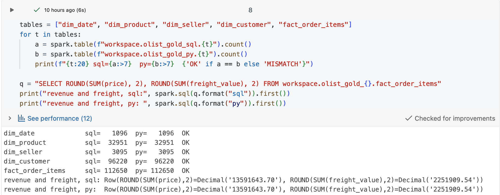
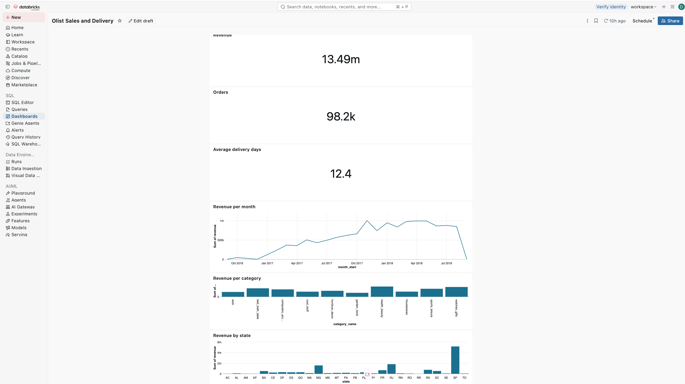

# Olist Lakehouse: Kimball Star Schema in Databricks

An end-to-end data pipeline in Databricks using the medallion architecture
(bronze, silver, gold) and Kimball dimensional modelling, with a dashboard.

**Dataset:** [Brazilian E-Commerce Public Dataset by Olist](https://www.kaggle.com/datasets/olistbr/brazilian-ecommerce)
(real orders from 2016 to 2018). Nine related tables, about 1.55 million rows.
All monetary values are in Brazilian reais (BRL).

| Table | Rows |
|---|---|
| geolocation | 1,000,163 |
| order_items | 112,650 |
| payments | 103,886 |
| orders / customers | 99,441 each |
| reviews | 99,224 |
| products | 32,951 |
| sellers | 3,095 |
| category translation | 71 |

## Architecture
Raw CSVs -> **Bronze** (raw Delta tables) -> **Silver** (cleaned, normalised)
-> **Gold** (Kimball star schema) -> **Dashboard**

Silver and gold were each built **twice**, once in SQL and once in PySpark,
and then reconciled.

## Layers

**Bronze** (`01_bronze_olist`)
- Loads all nine CSV files as-is (every column as a string) so ingestion never
  fails because of a bad value.
- Adds `_source_file` and `_ingested_at` metadata columns for lineage.

**Silver** (`03_silver_sql`, `04_silver_python`)
- Stays close to the normalised source: one table per entity, linked by keys.
- Removes duplicates with `ROW_NUMBER()`, standardises text, and converts types
  with `try_cast` so bad values become NULL instead of failing the job.

**Gold** (`05_gold_sql`, `06_gold_python`)
- Denormalised star schema for analytics.

## Data model (Kimball)
**Grain:** one row per order item.

- `fact_order_items`: price, freight, total value, delivery days, days versus
  estimate. `order_id` is a degenerate dimension.
- `dim_date`: one row per day. Used for purchase date and delivery date.
- `dim_product`: Type 1. English category name folded in from the translation table.
- `dim_seller`: Type 1.
- `dim_customer`: **Type 2 slowly changing dimension** with `valid_from`,
  `valid_to` and `is_current`. Each sale links to the address version that
  was valid at the time of the order.

**Normalisation vs dimensional modelling:** silver is normalised (each fact
stored once, good for integrity). Gold is deliberately denormalised into a
star schema so analysts need few joins and queries are simple.

**SCD2 caveat:** Olist records a delivery address per order, not a change log.
`valid_from` is the date of the first order at that address, not the actual
move date. About 122 of 96,096 customers have more than one address.

## Validation
SQL and Python results were reconciled: identical row counts for every silver
and gold table, and identical total revenue and freight on the fact table.

## Dashboard
Revenue trend, top product categories, revenue by state and delivery
performance, built on the gold layer. Cancelled and unavailable orders are
excluded from revenue figures.

## Tech stack
Databricks Free Edition, Delta Lake, Unity Catalog, Spark SQL, PySpark,
Databricks Dashboards

## Next steps
- Scheduled Databricks Jobs for the SQL and Python tracks
- Incremental ingestion with Auto Loader instead of full reloads
- Automated data quality checks that fail the pipeline
- Test on larger data volumes
